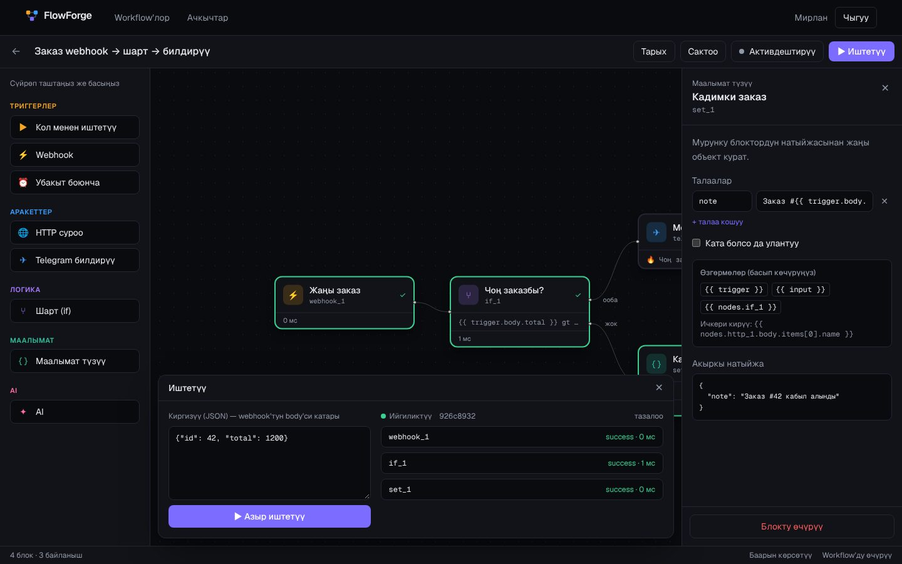

# FlowForge

**A visual workflow automation platform** — a mini n8n / Zapier. Connect blocks on a canvas to build automations without code: an event arrives (webhook, cron or manual), data is processed (HTTP, conditions, AI), and the result goes where it's needed (Telegram, any API).



## Features

- **Drag & drop editor** (React Flow) with a side panel for node settings and Ctrl+S to save.
- **Triggers:** manual, webhook (unique URL per workflow), cron with time zones.
- **Nodes:** HTTP request, if/else (two branches), set data, Telegram message, AI prompt (any OpenAI-compatible API: Groq, OpenAI, …).
- **Templating:** `{{ trigger.body.total }}`, `{{ nodes.http_1.body.items[0].name }}`, evaluated in a Jinja2 sandbox.
- **Live status** over WebSocket backed by Redis pub/sub, with a polling fallback.
- **Execution history** with per-step output, error and duration; graph snapshotted per run.
- **Security:** Fernet-encrypted credentials, SSRF guard on outgoing HTTP, body size limits, JWT auth, short-lived WebSocket tickets.
- **Error handling:** per-node "continue on error", max-steps guard, cycle detection.

## Stack

FastAPI · SQLAlchemy 2 · Alembic · PostgreSQL · Celery + Redis (worker & beat) · Next.js 16 · React 19 · @xyflow/react · Tailwind 4 · pytest (26 tests).

## Run

```bash
cp .env.example .env    # set SECRET_KEY
docker compose up --build
```

App: http://localhost:3100 · API docs: http://localhost:8100/docs

Tests: `cd backend && pytest -q`

## Deploy

One container on Render's free plan with `ROLE=all` (API + worker + beat), Neon for Postgres, Upstash or Render Key Value for Redis, Vercel for the frontend.
