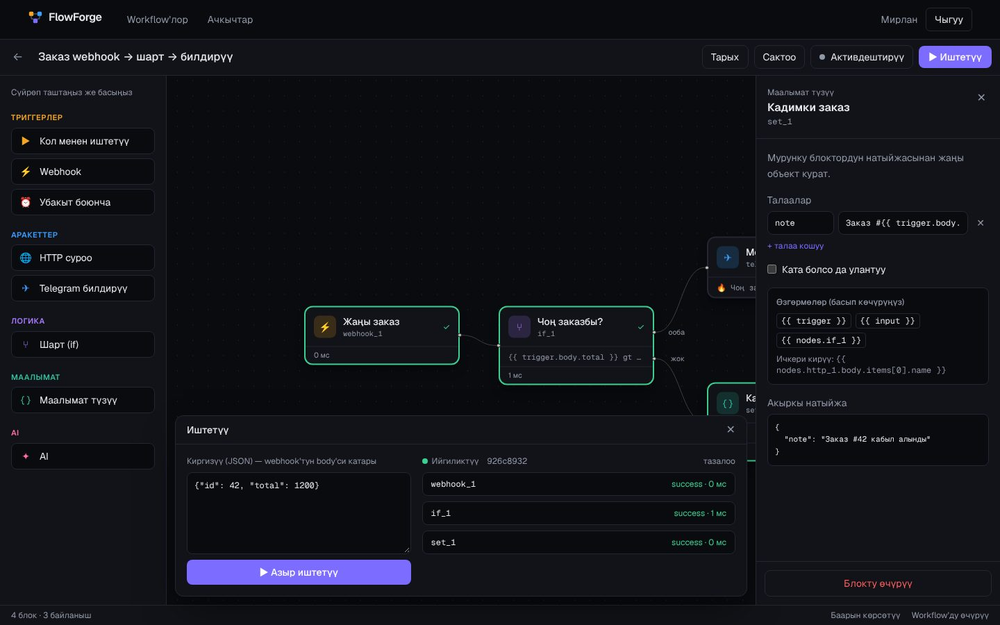
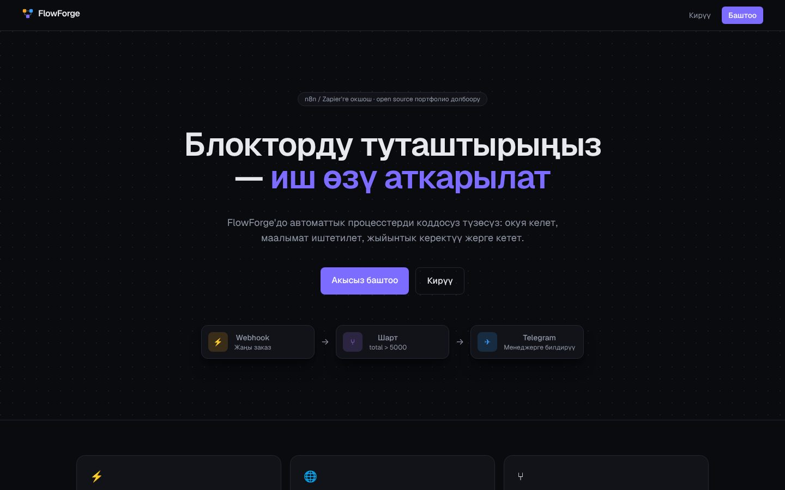
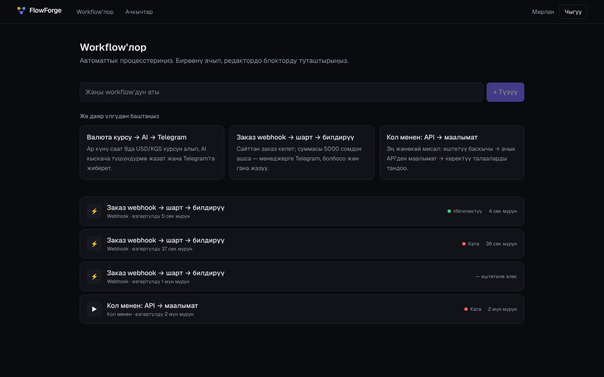
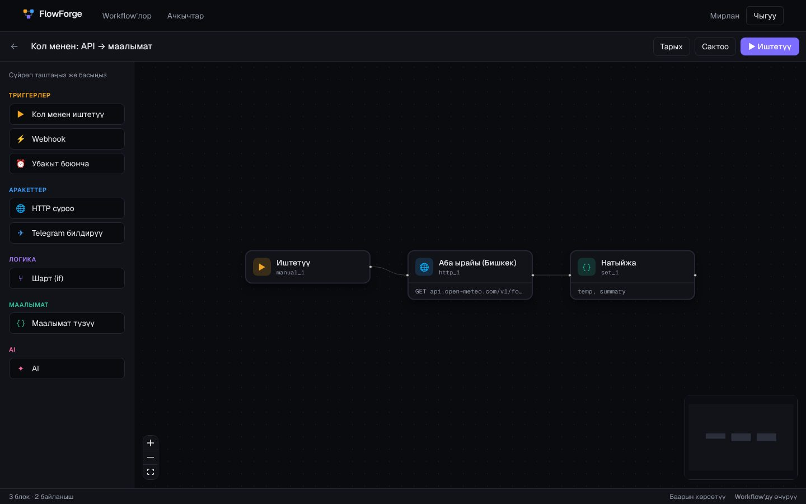
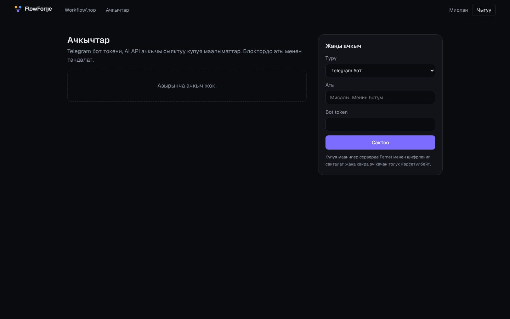

# FlowForge

**Визуалдык автоматташтыруу платформасы** — n8n / Zapier'дин мини-версиясы. Блокторду канваста туташтырып, коддосуз автоматтык процесстерди түзөсүз: окуя келет (webhook, cron же кол менен), маалымат иштетилет (HTTP, шарт, AI), жыйынтык керектүү жерге кетет (Telegram, API).

[English version](README.en.md)



## Мүмкүнчүлүктөр

- **Drag & drop редактор** (React Flow): блокторду сүйрөп таштоо, туташтыруу, параметрлерди каптал панелден өзгөртүү, Ctrl+S менен сактоо.
- **3 триггер:** кол менен, webhook (ар бир workflow'го уникалдуу URL), cron (убакыт алкагы менен).
- **Блоктор:** HTTP суроо, if/else шарт (эки бутак), маалымат түзүү, Telegram билдирүү, AI (OpenAI-шайкеш API: Groq, OpenAI ж.б.).
- **Шаблондор:** `{{ trigger.body.total }}`, `{{ nodes.http_1.body.items[0].name }}` — Jinja2 sandbox'та эсептелет.
- **Тирүү статус:** иштеп жатканда ар бир блок WebSocket (Redis pub/sub) аркылуу жашыл/кызыл болуп жанат; WebSocket жок болсо — polling'ке өтөт.
- **Тарых:** ар бир иштетүүнүн ар бир кадамынын натыйжасы, катасы жана убактысы сакталат.
- **Коопсуздук:** ачкычтар Fernet менен шифрленет; HTTP блогу ички тармакка суроолорду бөгөттөйт (SSRF); webhook'тун body'си чектелген; JWT аутентификация; WebSocket үчүн 60 секунддук өзүнчө билет.
- **Ката башкаруу:** блок үчүн «ката болсо да улантуу», кадамдар санынын чеги, циклдерди текшерүү.

## Архитектура

```
Next.js 16 (Server Actions, httpOnly cookie) ──► FastAPI ──► PostgreSQL
        ▲                                         │  ▲
        └──── WebSocket (тирүү статус) ◄── Redis pub/sub
                                                  │  │
                               Celery worker ◄────┘  └── Celery beat (cron, ар 30 сек)
```

| Катмар | Технология |
|---|---|
| Backend | FastAPI, SQLAlchemy 2, Alembic, Pydantic 2 |
| Кезек | Celery + Redis (worker + beat) |
| БД | PostgreSQL 16 |
| Frontend | Next.js 16 (App Router), React 19, @xyflow/react, Tailwind 4 |
| Тесттер | pytest (26 тест: движок, API, webhook, cron, шифрлөө, WebSocket) |

Workflow граф катары JSON'до сакталат. Иштетүүдө граф snapshot кылынат (кийин өзгөртүлсө да тарых туура калат), триггерден баштап BFS менен басылат; `logic.if` блогу `true`/`false` бутагын тандайт.

## Иштетүү (Docker)

```bash
cp .env.example .env        # SECRET_KEY'ди өзгөртүңүз
docker compose up --build
```

- Сайт: http://localhost:3000
- API документация: http://localhost:8000/docs

Катталып, даяр үлгүлөрдүн бирин ачып, **▶ Иштетүү** басыңыз.

### Webhook'ту сыноо

Workflow'ду активдештирип, webhook блогундагы URL'ди көчүрүңүз:

```bash
curl -X POST http://localhost:8000/api/hooks/<token> \
  -H "Content-Type: application/json" -d '{"id": 42, "total": 9000}'
```

### Docker'сиз (иштеп чыгуу үчүн)

```bash
cd backend && pip install -r requirements.txt
alembic upgrade head && uvicorn app.main:app --reload
celery -A app.worker.celery_app worker -B -l info     # өзүнчө терминалда
cd frontend && npm install && npm run dev
```

Тесттер: `cd backend && pytest -q`

## Акысыз API'лер

Бардык үлгүлөр акысыз сервистерде иштейт: [open.er-api.com](https://open.er-api.com) (валюта), [Open-Meteo](https://open-meteo.com) (аба ырайы), Telegram Bot API, [Groq](https://console.groq.com) (AI, акысыз ачкыч).

## Жайгаштыруу

Render'дин акысыз планына бир контейнер жетиштүү: `ROLE=all` API'ни, worker'ди жана beat'ти бир процессте иштетет. БД — Neon, Redis — Upstash же Render Key Value, frontend — Vercel (`API_URL`, `PUBLIC_API_URL`).

## Скриншоттор

| | |
|---|---|
|  |  |
|  |  |
